# CubeSar 6U

Student 6U CubeSat by [Space Eagle](https://www.spaceeagle.it), a student rocketry and space association in Italy. I am the Project Manager of the program.

CubeSar is built to carry **IceRoute**, an onboard AI payload that segments Arctic sea ice from Sentinel-1 SAR images and computes the ship route directly on the satellite. It sends to the ground only the ice mask and the route, about 200 times less data than the raw scene. IceRoute won **first prize at the ESA EO MakerSpace Hackathon** (ESA ESRIN, Frascati, June 2026), and this CubeSat program started right after.

  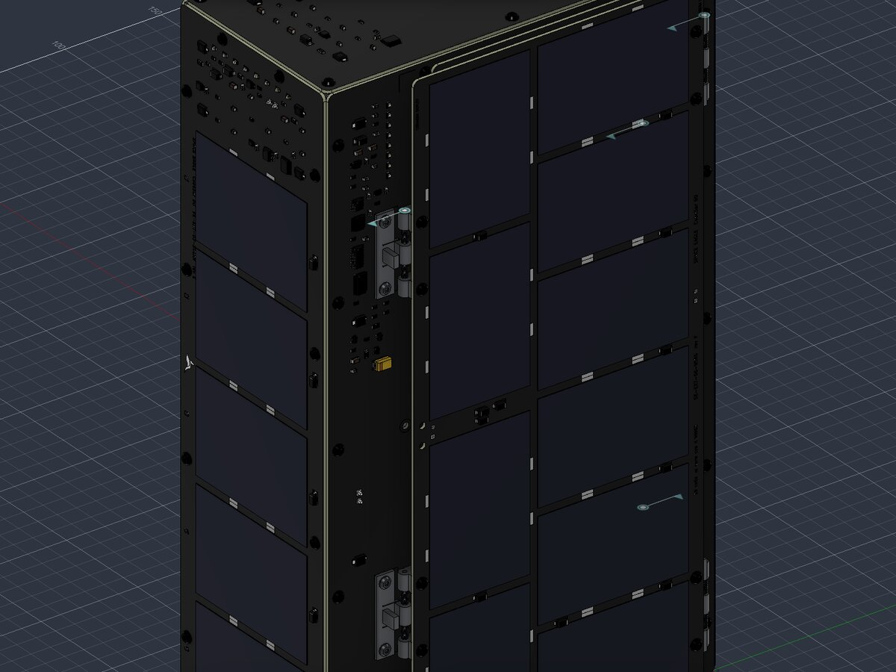
  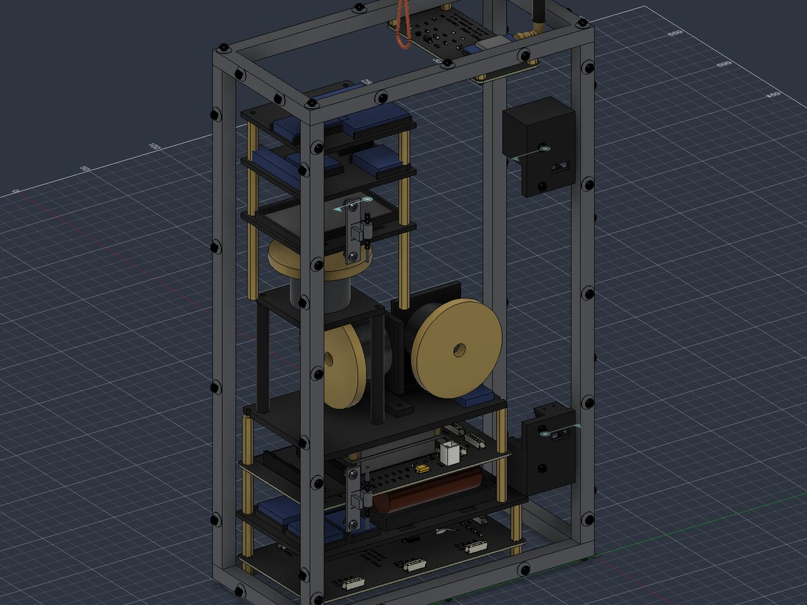

**Status (rev I, September 2026):** engineering prototype, complete for fabrication, assembly and bench testing. Mechanical CAD, avionics and all 10 PCBs are done. We are now looking for a PCB manufacturing sponsor.

> CubeSar is a bench prototype, not a flight model. The goal is to build and test the full satellite on the ground and to demo IceRoute running on real hardware.

## Architecture

| Subsystem | What is inside |
|:--|:--|
| **OBC** | ESP32-S3 for housekeeping and control, Raspberry Pi Zero 2 W with pHAT running the IceRoute payload |
| **ADCS** | 3-axis attitude control with 3 reaction wheels: GM2804 gimbal motors, AS5048A magnetic encoders, 60 mm flywheels |
| **Motor drive** | 3 SimpleFOC Mini drivers, each with its own TPS61088 boost converter |
| **EPS** | 1S2P battery pack, 10 A BMS, MPPT stages at 6 V and 9 V |
| **Power generation** | Body-mounted and deployable solar panels (WING with 10 cells, WING2 with 8 cells) |
| **Comms** | 2.4 GHz radio module (Ebyte) on its own board |
| **Expansion** | Free GPIO on the Pi and spare connectors for future payloads |

## Deployable panels

The solar wings open in six steps, with hinges, mechanical end stops and a secondary panel (WING2).

  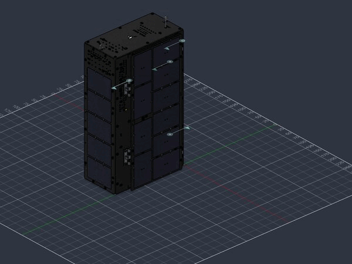

All six phases

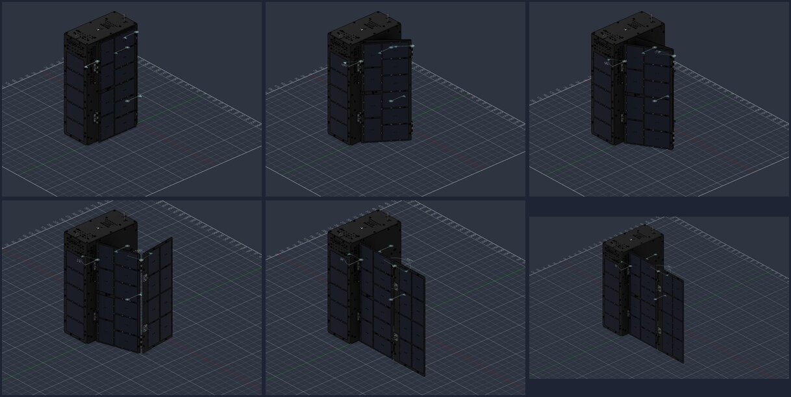

## PCBs

All boards are designed in KiCad, with ERC and DRC passing clean. The renders below come from the final KiCad projects. Every board is 2 layers.

| Board | Size | Notes |
|:--|:--|:--|
| SE-EXT-00 HUB | 80 x 150 mm | |
| SE-EXT-01 LOGO | 200 x 340 mm | Radar window |
| SE-EXT-02 DEPLOY | 200 x 340 mm | |
| SE-EXT-03 SOLAR | 100 x 340 mm | Solar panel, 2 pieces |
| SE-EXT-04 TOP | 100 x 200 mm | Antenna and release cord |
| SE-EXT-05 BOTTOM | 100 x 200 mm | |
| SE-EXT-06 WING | 150 x 340 mm | Deployable wing, 10 solar cells |
| SE-EXT-07 WING2 | 136 x 340 mm | Secondary wing, 8 solar cells |
| SE-EXT-08 COMMS | 96 x 44 mm | 2.4 GHz radio |
| SE-EXT-09 OBC | 80 x 140 mm | ESP32-S3 + Raspberry Pi |

<table>
  <tr>
    <td align="center">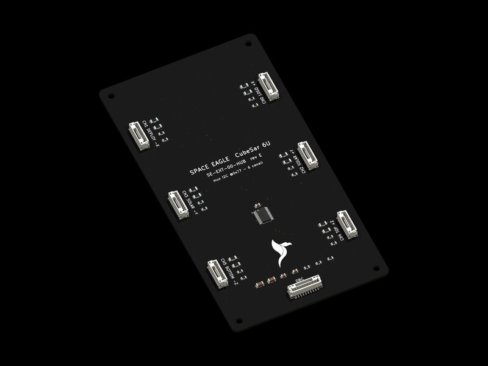 00 HUB</td>
    <td align="center">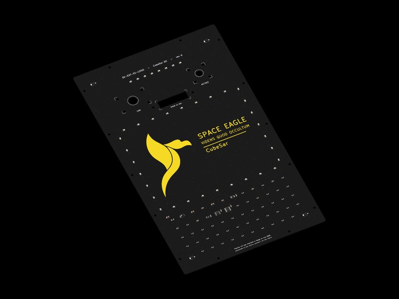 01 LOGO</td>
    <td align="center">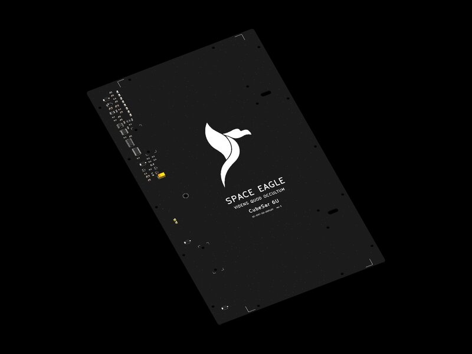 02 DEPLOY</td>
    <td align="center">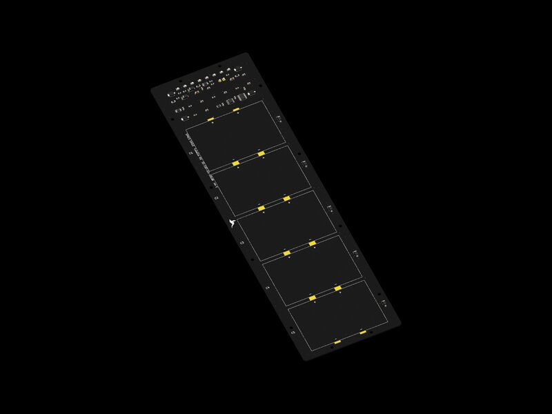 03 SOLAR</td>
    <td align="center">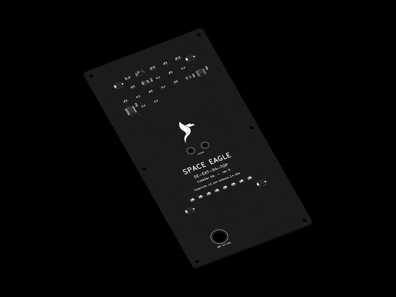 04 TOP</td>
  </tr>
  <tr>
    <td align="center">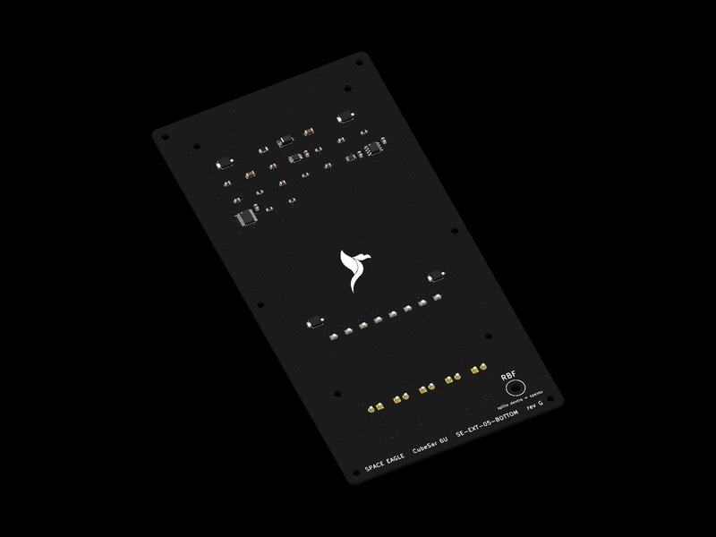 05 BOTTOM</td>
    <td align="center">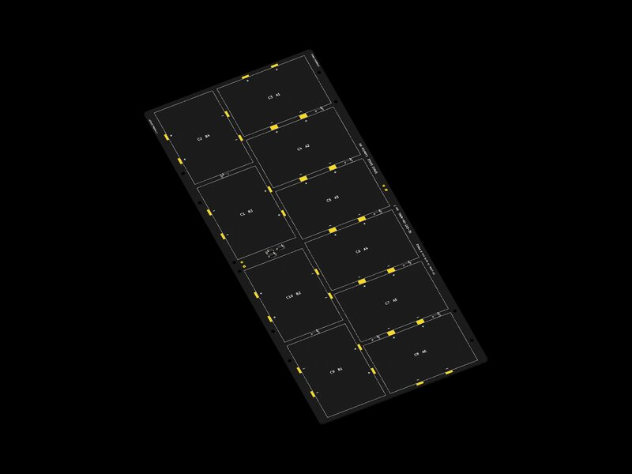 06 WING</td>
    <td align="center">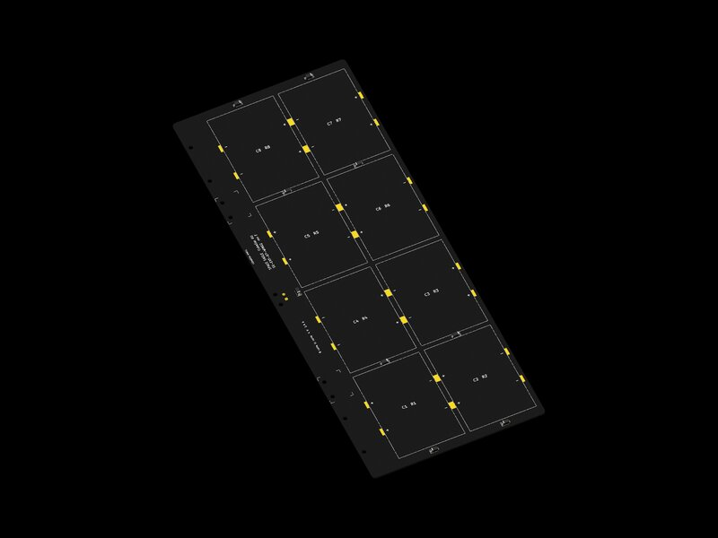 07 WING2</td>
    <td align="center">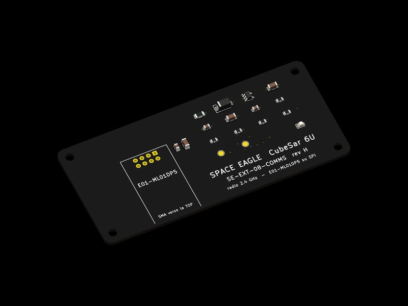 08 COMMS</td>
    <td align="center">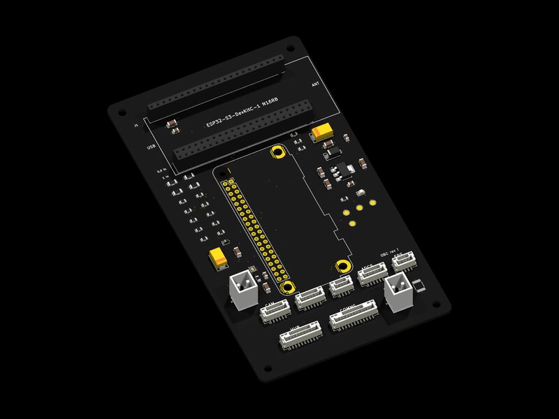 09 OBC</td>
  </tr>
</table>

## Production package

| CAD and printing | PCB | Purchasing |
|:--|:--|:--|
| Full assembly in Fusion 360 (F3D) | 10 KiCad projects | Bill of materials (XLSX) |
| Full assembly in STEP | ERC and DRC clean | Direct supplier links |
| 28 verified STL files | Gerber and drill files | Required part variants |
| Internal and external renders | Schematics and panels in PDF | ADCS pinout and wiring |

Before the first power-on we check polarity, encoder cable continuity, current limit, flywheel balance and temperatures.

## Where it started

The first version of the project (summer 2026) was a smaller ground demonstrator: a 2U CubeSat mock-up on a linear rail that emulates the orbit, with two Acconeer A121 60 GHz radars to form a synthetic aperture. Because the target was inside the near field, the image is formed with time-domain back-projection instead of classic range-Doppler algorithms. The idea was the same as IceRoute: process on board and send down only the answer, around 200 bytes instead of 2.1 MB of raw data.

The radar was never the claim, since the A121 is a commercial part not rated for space. The claim is the onboard processing and the small ground segment it allows. That idea then grew into the 6U platform above, with IceRoute as the payload.

## Team

Space Eagle CubeSat team: Federico Fassio (Project Manager), Giuseppe Mondilla (Space Eagle President), Lorenzo Razzano, Simone Avella. Advisor: Dr. Riccardo Apa.

## Contact

Federico Fassio, [federicofassio.it](https://federicofassio.it)

If you want to support the build (PCB fabrication, components, testing), get in touch.
